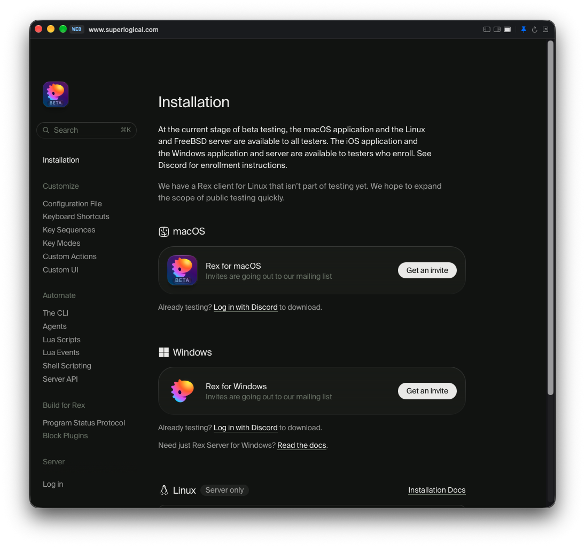
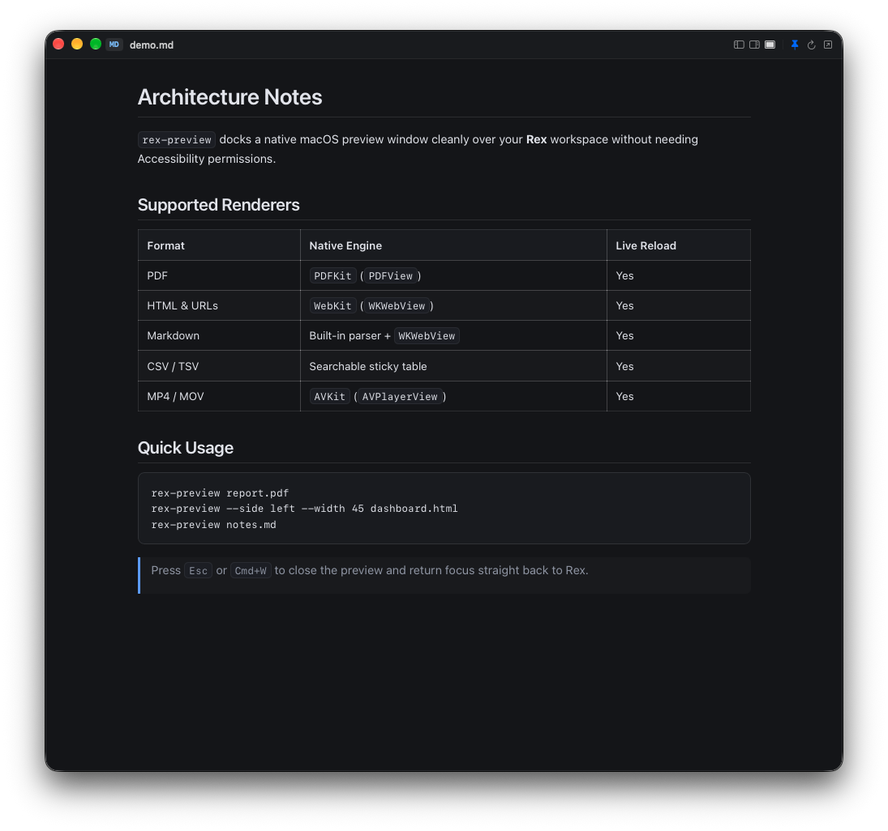
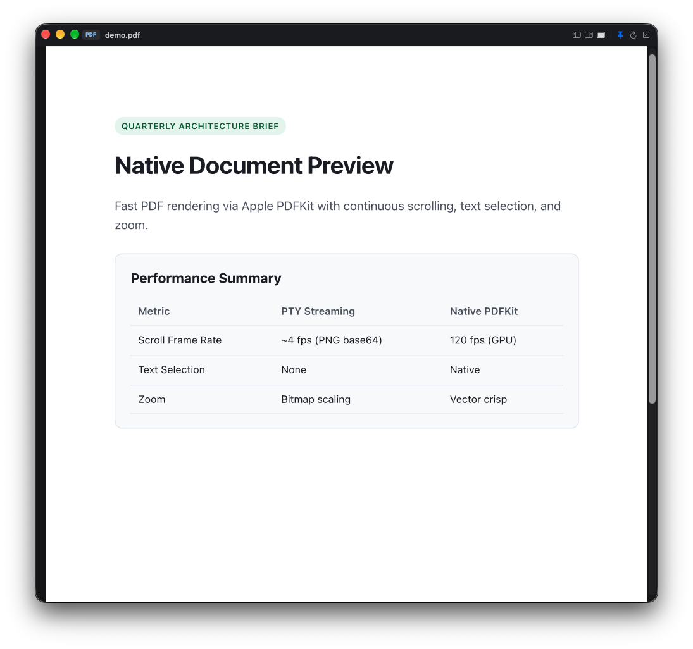

# rex-preview

A native macOS quick-preview companion for [Rex](https://www.superlogical.com/rex).

Rex streams terminal panes over a client-server socket. Pixel-based terminal viewers have to base64-encode full PNG frames on every scroll tick, which feels laggy on Retina displays. `rex-preview` solves this by opening a lightweight native macOS window docked cleanly over your Rex workspace. It renders with Apple `PDFKit`, `WebKit`, `AVKit`, and `QuickLookUI` at native 120fps, with zero third-party dependencies and no Accessibility permissions required.

## Screenshots

### HTML & Web (`WKWebView`, live reload on save)


### Markdown (built-in dark renderer + `WKWebView`, live reload on save)


### PDF (`PDFKit`, vector zoom and native text selection)


## Supported file types

| Format | Extensions / Input | Native engine | Live reload |
| --- | --- | --- | --- |
| PDF | `.pdf` | `PDFKit` (`PDFView`) | Yes |
| HTML & URLs | `.html`, `.htm`, `http://`, `https://` | `WebKit` (`WKWebView`) | Yes (local files) |
| Markdown | `.md`, `.markdown`, `.mdx` | Built-in parser + `WKWebView` | Yes |
| CSV / TSV | `.csv`, `.tsv` | Searchable sticky table in `WKWebView` | Yes |
| Images | `.png`, `.jpg`, `.jpeg`, `.gif`, `.webp`, `.svg`, `.heic` | `WKWebView` | Yes |
| Video | `.mp4`, `.mov`, `.m4v`, `.webm` | `AVKit` (`AVPlayerView`) | Yes |
| Everything else | `.docx`, `.xlsx`, `.pptx`, code, text, etc. | `QuickLookUI` (`QLPreviewView`) | Yes |

## Install

Requires macOS 14 or newer and Swift 6 (Xcode Command Line Tools).

```sh
git clone https://github.com/JCSnap/rex-preview.git
cd rex-preview
./scripts/install.sh
```

This builds a release binary and installs it to `~/.local/bin/rex-preview`.

## Usage

```sh
# Dock over the right half of Rex's content area (default)
rex-preview report.pdf
rex-preview dashboard.html
rex-preview README.md

# Dock on the left or center, or set a custom width percentage
rex-preview --side left --width 45 notes.md
rex-preview --side center --width 70 deck.pdf
rex-preview --side full https://localhost:3000

# Stay attached to the terminal until the preview window closes
rex-preview --wait report.pdf
```

`rex-preview` detaches by default so your shell prompt returns immediately. It detects Rex's frontmost workspace window through `CGWindowListCopyWindowInfo` and reads Rex's sidebar width from `com.superlogical.rex` preferences, so docking respects your sidebar without asking for Accessibility permissions.

## Keyboard shortcuts

| Shortcut | Action |
| --- | --- |
| `Esc` or `Cmd+W` | Close preview and return focus to Rex |
| `Cmd+R` | Reload file or page |
| `Cmd+O` | Open in default macOS app |
| `Cmd++` / `Cmd+-` / `Cmd+0` | Zoom in, zoom out, reset zoom |

## License

MIT. See [LICENSE](LICENSE).
